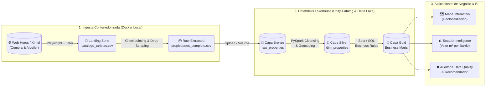

# 🏛️ Horus Real Estate Lakehouse: End-to-End Data Engineering Pipeline

Pipeline integral de Ingeniería de Datos diseñado para la extracción automatizada, normalización, geocodificación y modelado analítico del catálogo inmobiliario de **Inmobiliaria Horus (La Rioja, Argentina)**.

El proyecto resuelve la fragmentación de datos inmobiliarios (originalmente dispersos en grillas paginadas por JavaScript y fichas individuales en HTML/CRM Xintel) transformándolos en un **Data Lakehouse** gobernado bajo la **Arquitectura Medallion (Bronze, Silver, Gold)** en Databricks.

---

## 📐 Arquitectura del Pipeline (End-to-End)

---

⚙️ Decisiones de Ingeniería y Buenas Prácticas

1. Extracción Resiliente y Ética (Anti-Ban & Rate Limiting)
   Navegación Dinámica sobre JS: El catálogo web implementa paginación asíncrona mediante llamadas a funciones nativas del DOM (traerPagina(i)). El extractor utiliza Playwright para controlar el estado de red (networkidle) y recolectar la totalidad de páginas de Compra (ope=V) y Alquiler (ope=A).

Algoritmo de Jitter y Coffee Breaks: Para proteger la estabilidad del servidor de origen y evitar bloqueos por rate-limiting, el motor aplica pausas aleatorias uniformes con decimales (2.5s a 5.8s) entre peticiones, combinadas con pausas extendidas de enfriamiento (15s a 28s) cada 25 fichas procesadas.

2. Idempotencia, Tolerancia a Fallos y Checkpointing
   Persistencia Incremental en dos etapas: El pipeline separa el descubrimiento de tarjetas (Fase 1: Landing URLs) de la extracción profunda de cada inmueble (Fase 2: Raw Extracted).

Recuperación ante Interrupciones: Cada propiedad extraída se persiste en tiempo real. Si la ejecución se detiene por corte de red o mantenimiento, al reiniciar el contenedor el sistema audita los identificadores únicos (V_hia435, A_hia909, etc.) ya procesados y retoma exactamente desde el último punto pendiente sin duplicar registros.

3. Sanitización de Esquema para Apache Spark y Delta Lake
   Las fichas inmobiliarias contienen decenas de atributos dinámicos según la tipología (lotes, casas, galpones, locales).

El parser con BeautifulSoup4 filtra automáticamente los nodos ocultos (display:none) o vacíos de la plantilla HTML y normaliza las etiquetas dinámicas a formato snake_case libre de tildes y caracteres especiales (limpiar_nombre_columna), previniendo errores de lectura de metadatos en Delta Lake.

4. Reproducibilidad con Docker
   Construido sobre la imagen oficial de Microsoft mcr.microsoft.com/playwright/python:v1.63.0-noble (Ubuntu 24.04 LTS), garantizando paridad exacta entre los binarios de Chromium y la librería de Python.

Configuración optimizada de memoria compartida (shm_size: '2gb' e ipc: host) en docker-compose.yml para evitar colapsos del motor Chromium durante ejecuciones prolongadas.

---

🗂️ Estructura del Repositorio

horus-real-estate-lakehouse/
├── config/
│   └── settings.py          # Configuración centralizada, rutas y variables de entorno
├── data/                    # Volumen persistente (excluido de Git vía .gitignore)
│   ├── landing_urls/        # Fase 1: Catálogo de tarjetas y enlaces 'Ver más'
│   └── raw_extracted/       # Fase 2: Dataset unificado (Tarjetas + Detalles + Medidas)
├── databricks/              # Notebooks de PySpark y Spark SQL para el Lakehouse
│   ├── 01_bronze_ingestion.py
│   ├── 02_silver_cleansing_geocoding.py
│   └── 03_gold_business_marts.sql
├── logs/                    # Telemetría y registro de eventos (pipeline.log)
├── src/                     # Código fuente modular del extractor
│   ├── __init__.py
│   ├── utils.py             # Logger, Jitter, Checkpointing e I/O incremental
│   ├── extractor.py         # Parsing del DOM (Grilla de tarjetas y Ficha interna)
│   └── main.py              # Orquestador del flujo de extracción
├── .env.example             # Plantilla de parámetros de ejecución
├── .gitignore               # Reglas de exclusión de datos crudos y binarios
├── Dockerfile               # Definición de imagen basada en Playwright v1.63.0-noble
├── docker-compose.yml       # Orquestación de servicios y mapeo de volúmenes
└── requirements.txt         # Dependencias fijadas (pinned versions)

---

🎯 5 Casos de Uso de Negocio (Capa Gold)
Los datos estructurados en este pipeline habilitan cinco soluciones directas para la gestión comercial de la inmobiliaria y la experiencia de sus clientes:

🗺️ Explorador Geoespacial Interactivo: Geocodificación de las direcciones normalizadas (detalle_direccion + detalle_barrio en La Rioja) para alimentar un mapa interactivo con filtros por operación, rango de precio y tipología.

📈 Tasador Inteligente (Monitor del Valor del $m^2$): Cálculo automatizado del valor promedio, mediana y desvíos del $m^2$ (total, cubierto y de terreno) segmentado por barrio (Vargas, Evita, Centro, Altos de Infantería, etc.) para respaldar tasaciones con datos reales del mercado local.

🩺 Auditoría Automatizada de Calidad de Cartera (Data Quality): Detección proactiva de fichas publicadas en el CRM con datos faltantes críticos (sin precio, sin superficie cargada, sin dirección o con inconsistencias entre dormitorios y metraje) para su corrección administrativa.

🤝 Motor de Recomendación de Propiedades Similares: Microservicio de matchmaking que, ante la consulta de un cliente por una ficha específica (ej. hia435), sugiere automáticamente las 3 propiedades más similares en cartera según barrio, dormitorios y banda de precios ($\pm 15\%$).

🤖 Asistente Conversacional sobre Inventario Real (RAG Ready): El campo enriquecido ficha_descripcion_completa junto con los vectores de características (Gas natural, Cochera, Cloaca, Piscina) prepara el catálogo para consultas en lenguaje natural mediante modelos de lenguaje (LLMs).

🚀 Guía de Ejecución Rápida
Prerrequisitos
a. Docker Desktop instalado y en ejecución.
b. Git y Visual Studio Code.

1. Clonar el repositorio y configurar variables

git clone [https://github.com/AleHerreraSoria/horus-real-estate-lakehouse.git](https://github.com/AleHerreraSoria/horus-real-estate-lakehouse.git)
cd horus-real-estate-lakehouse

Ajustar los parámetros en .env.example según el modo deseado:
LIMIT_PAGES_TEST=2: Ejecuta un Smoke Test rápido (primeras 2 páginas de Compra y 2 de Alquiler).
LIMIT_PAGES_TEST=0: Ejecuta la extracción completa de todo el catálogo.

2. Construir y ejecutar el contenedor de extracción

docker compose up --build

Los archivos extraídos se actualizarán en vivo dentro de
data/raw_extracted/propiedades_horus_completo.csv y el progreso detallado quedará registrado en logs/pipeline.log.

👤 AutorAlejandro Herrera
Data Engineer
📍 Córdoba, Argentina
